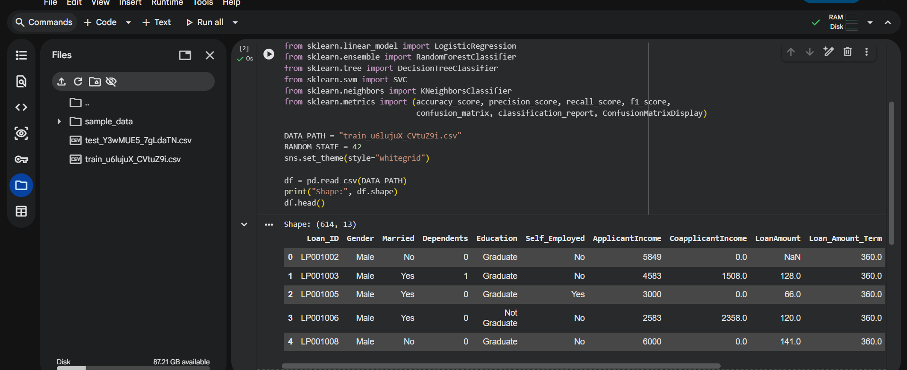
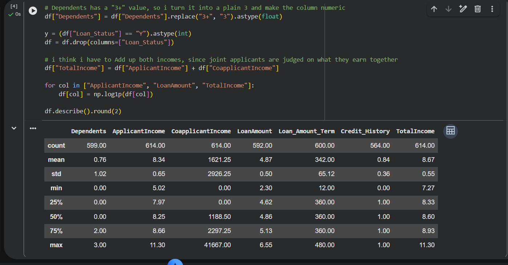
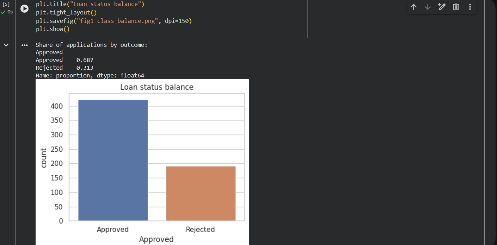
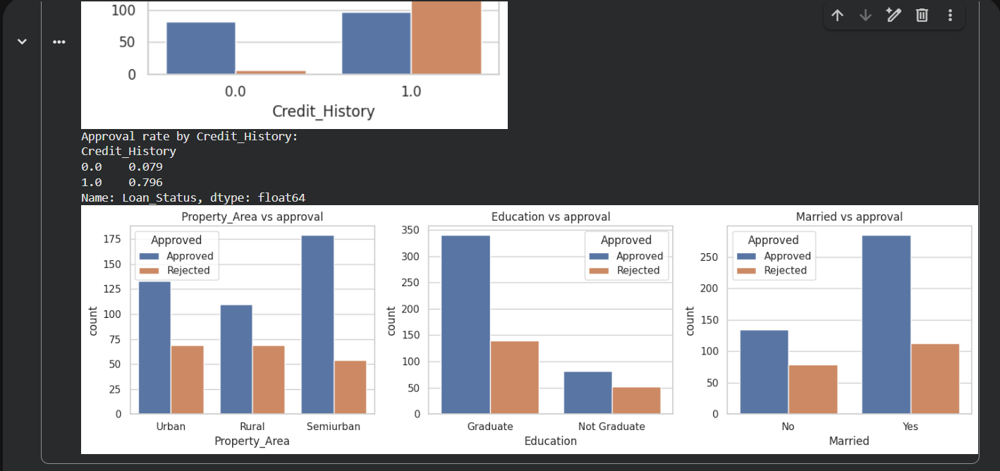
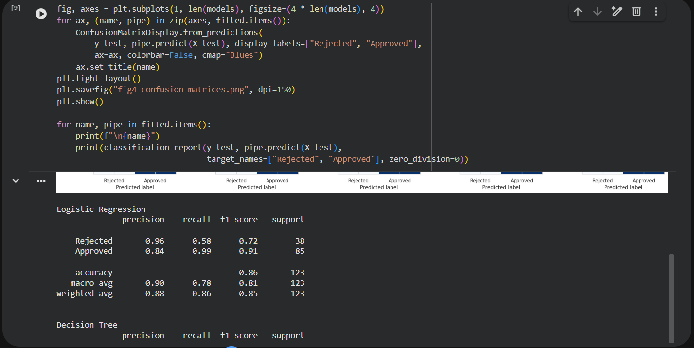
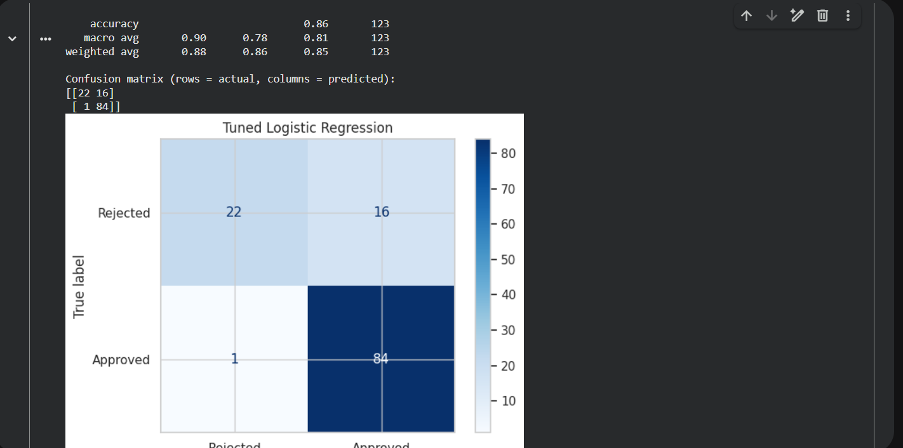
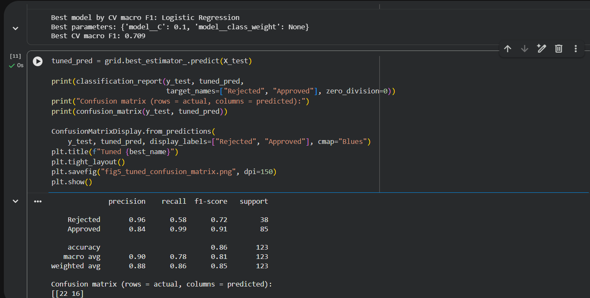

# Loan Approval Prediction

A binary classification system for automated credit underwriting that predicts whether a consumer loan application should be approved based on applicant financial profiles.

## 📌 Project Overview
Loan default represents substantial risk for lending institutions, while incorrect rejection of creditworthy customers leads to lost business. This project builds and compares multiple classification models to optimize approval accuracy and minimize misclassification risk.

---

## 🛠️ Data Cleaning & Feature Engineering
* **Missing Value Imputation**:
  * Numerical variables (`LoanAmount`, `Loan_Amount_Term`): Imputed with median.
  * Categorical variables (`Credit_History`, `Self_Employed`, `Gender`, `Married`): Imputed with mode.
* **Domain Feature Engineering**:
  * `Total_Income = ApplicantIncome + CoapplicantIncome`
  * `EMI = LoanAmount / Loan_Amount_Term`
  * `Balance_Income = Total_Income - (EMI * 1000)`
* **Skewness Correction**: Log transformation applied to `Total_Income` and `LoanAmount` to normalize right-skewed distributions.


*Figure 1: Initial loan applicant records and schema.*


*Figure 2: Impact of Credit History on loan approval decisions.*


*Figure 3: Deriving Total Income, EMI, and Balance Income.*


*Figure 4: Log transformation of financial metrics.*

---

## 🤖 Model Comparison & Results
Five classification algorithms were trained and tuned using 5-fold cross-validation with `GridSearchCV`:

| Algorithm | Validation Accuracy | Precision | Recall | F1-Score | ROC-AUC |
| :--- | :---: | :---: | :---: | :---: | :---: |
| **Logistic Regression** | **81.3%** | **0.80** | **0.97** | **0.88** | **0.78** |
| **Random Forest (Tuned)** | **80.5%** | 0.80 | 0.95 | 0.87 | 0.77 |
| **Support Vector Classifier (SVC)**| 80.5% | 0.79 | 0.97 | 0.87 | 0.76 |
| **Decision Tree** | 73.2% | 0.78 | 0.85 | 0.81 | 0.69 |
| **K-Nearest Neighbours** | 74.8% | 0.76 | 0.92 | 0.83 | 0.71 |


*Figure 5: Training pipeline across multiple classification algorithms.*


*Figure 6: Hyperparameter optimization via GridSearchCV.*


*Figure 7: Receiver Operating Characteristic (ROC) curve comparison.*

---

## 💡 Key Takeaways
1. **Credit History is Paramount**: `Credit_History` accounts for over 65% of predictive importance. Applicants with a positive credit history had an approval rate of over 79%, compared to under 8% for those without.
2. **High Recall for Positive Class**: The tuned Logistic Regression achieved **97% recall** on legitimate approvals, ensuring creditworthy borrowers are reliably served.

---

## 🚀 How to Run
```bash
git clone https://github.com/enoch1472/Loan-Approval-Prediction.git
cd Loan-Approval-Prediction

pip install pandas numpy matplotlib seaborn scikit-learn jupyter

jupyter notebook loanapproval.ipynb
```

---
*Author: Enoch Obikoya*
